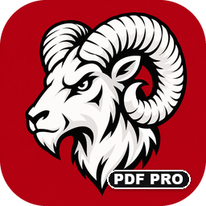
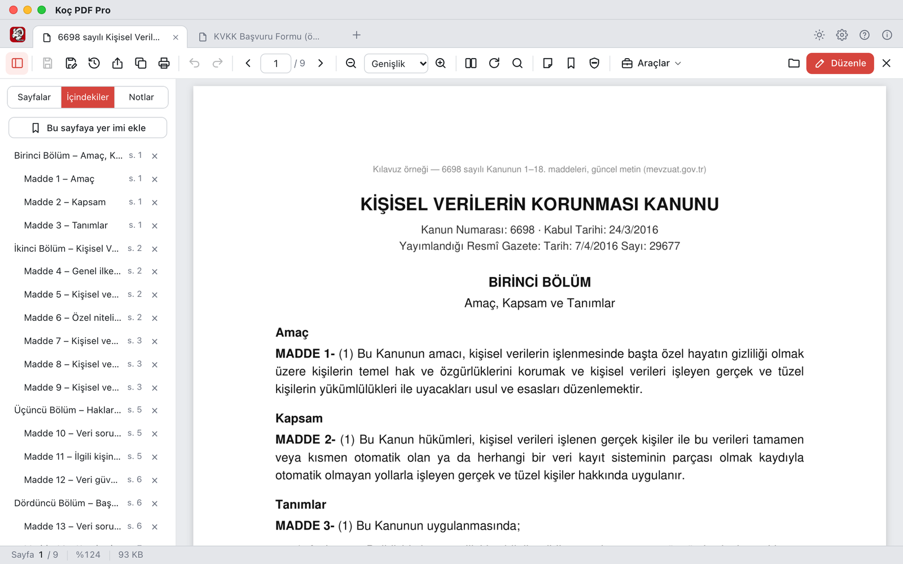
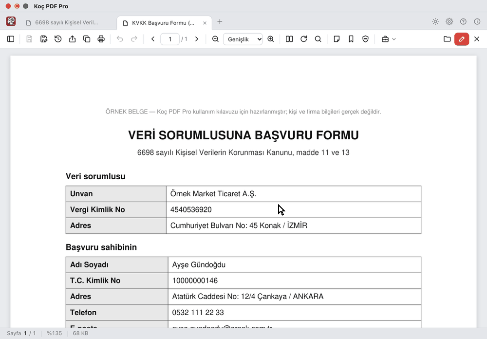
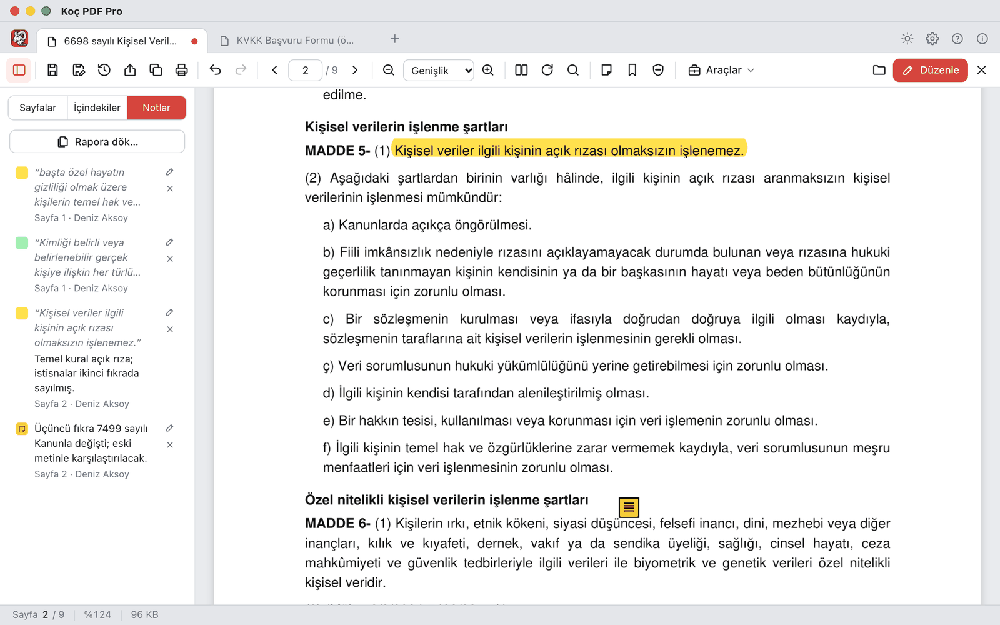
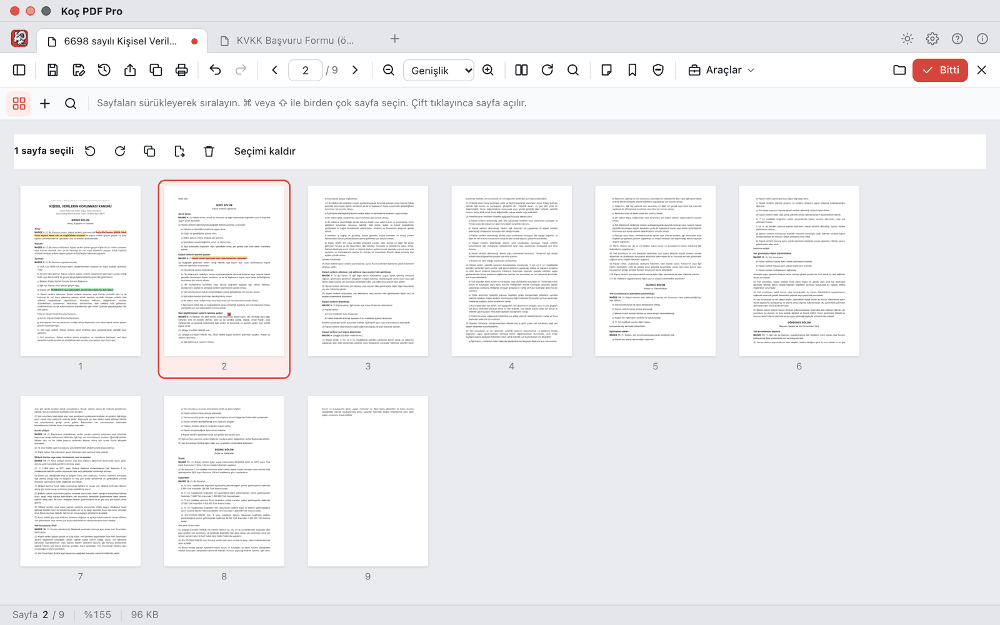
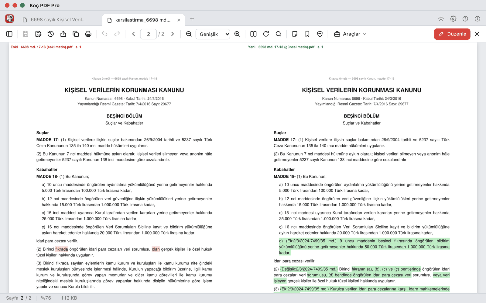
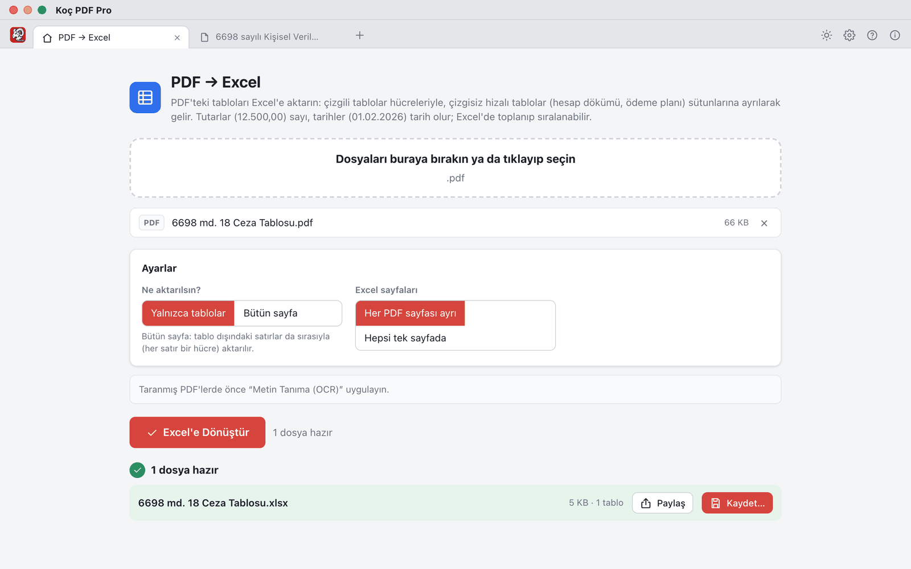

<h1 align="center">Koç PDF Pro</h1>

  Mac ve Windows için ücretsiz, açık kaynak PDF uygulaması. 
  Okuma, not, düzenleme, dönüştürme, UYAP UDF, metin tanıma ve kişisel veri karartma: hepsi internetsiz.

  <a href="https://github.com/hasankoc1996-eng/koc-pdf-pro/releases/latest/download/KocPDFPro.pkg"><b>Mac için indir</b></a>
  &nbsp;·&nbsp;
  <a href="https://github.com/hasankoc1996-eng/koc-pdf-pro/releases/latest/download/KocPDFPro-Kurulum.exe"><b>Windows için indir</b></a>
  &nbsp;·&nbsp;
  <a href="https://github.com/hasankoc1996-eng/koc-pdf-pro/releases">Bütün sürümler</a>

  
  
  

<picture>
  <source media="(prefers-color-scheme: dark)" srcset="docs/gorseller/ana-gorsel-gece.png">
  
</picture>

## Öne çıkanlar

- **İnternet gerekmez.** Belgeleriniz bilgisayarınızda işlenir; hiçbir sunucuya gönderilmez.
- **Kişisel verileri karartma (KVKK).** T.C. kimlik no, IBAN, telefon, e-posta, ad soyad… tek tıkla bulunur;
  seçtikleriniz belgeden kalıcı olarak silinir.
- **UYAP belgeleri.** UDF dosyalarını açar, PDF'e ve Word'e çevirir; Word ve PDF belgelerinden UDF üretir. Word
  gerekmez.
- **Türkçeyi bilen arama.** Büyük-küçük harf (I/ı, İ/i), şapkalı harfler, satır sonunda bölünmüş kelimeler; açık
  belgelerin hepsinde birden.
- **PDF'teki yazıyı düzeltme.** Var olan metni yerinde düzenleyin; yazı tipi belgedekine uydurulur. Bul ve değiştir de
  var.
- **E-imzalı belgeye not.** Vurgu, not ve yer imi e-imzayı bozmadan eklenir.
- **İki sürümü karşılaştırma.** Kanunun eski ve yeni metni, sözleşme taslakları: silinenler kırmızı, eklenenler yeşil.
- **PDF'teki tabloyu Excel'e.** Hesap dökümü, ödeme planı: tutarlar sayı, tarihler tarih olarak aktarılır.
- **Metin tanıma (OCR).** Taranmış belgeyi aranabilir ve kopyalanabilir yapar; bu da internetsiz.
- **İmza ve kaşe.** İmzanızı bir kez çizin ya da resminden yükleyin, sonra tek tıkla koyun; “ASLI GİBİDİR” kaşesi
  tarih ve ad soyadla basılır.
- **Hiçbir şey kaybolmaz.** Her kaydedişte eski hâl **Önceki sürümler**'de saklanır; uygulama beklenmedik şekilde
  kapanırsa değişiklikler kurtarılır.
- **Ücretsiz ve açık kaynak.** Reklam yok, hesap yok, abonelik yok. Yeni sürümler uygulamanın içinden kurulur.

## Kişisel verileri tek tıkla karartın

Belgeyi başkasıyla paylaşmadan önce **KVKK** düğmesine basın: uygulama kişisel verileri bulur, siz bakıp seçersiniz,
seçtikleriniz siyah kutuyla kapatılıp alttaki yazıyla birlikte belgeden silinir. Karartılan yer seçilip kopyalanamaz,
aramada da çıkmaz.

Görseldeki form ve bilgiler örnektir, gerçek kişilere ait değildir.

## Ekranlar

<table>
  <tr>
    <td width="50%"> <b>Not ve vurgu:</b> renkli vurgu, yapışkan not, not raporu. Acrobat'ta ve Önizleme'de de görünür.</td>
    <td width="50%"> <b>Sayfa düzeni:</b> sürükleyerek sıralayın; döndürün, silin, çoğaltın, araya sayfa ekleyin.</td>
  </tr>
  <tr>
    <td width="50%"> <b>Karşılaştır:</b> eski ve yeni sayfalar yan yana, değişiklikler boyalı.</td>
    <td width="50%"> <b>PDF → Excel:</b> çizgili ve çizgisiz tablolar, Türkçe tutar ve tarih biçimleriyle.</td>
  </tr>
</table>

## Bütün özellikler

- **Okuma:** sekmeler, içindekiler, sayfadaki bağlantılar, Türkçe kurallarıyla arama (büyük-küçük harf, şapkalı
  harfler, satır sonunda bölünmüş kelimeler), açık belgelerin hepsinde arama, kaldığı sayfadan açma, şifreli PDF.
- **Not ve vurgu:** renkli vurgu, notlu vurgu, yapışkan not, yer imi; not raporu. Notlar standart PDF notudur,
  Acrobat'ta ve Önizleme'de de görünür.
- **Düzenleme:** var olan metni düzenleme, metin ekleme, bul ve değiştir, beyaz kutu, çerçeve, kalem, resim, imza ve
  kaşe, form doldurma; sayfaları sıralama, döndürme, silme, çoğaltma, araya PDF / resim / Word / boş sayfa ekleme.
  Her adım geri alınabilir.
- **Kişisel verileri karartma (KVKK):** T.C. kimlik no, vergi kimlik no, IBAN, kart numarası, telefon, e-posta ve ad
  soyadları bulur; seçtiklerinizi belgeden kalıcı olarak siler.
- **E-imzalı belgeler:** not, vurgu ve yer imi imzayı bozmadan eklenir.
- **Dönüştürme:** Word ↔ PDF, Excel ↔ PDF, UYAP UDF ↔ PDF / Word, resim (JPG, PNG, HEIC, TIFF) ↔ PDF.
- **Araçlar:** birleştir, böl, sıkıştır, sayfa no / ek no, filigran, şifrele / şifre kaldır, iki PDF'i karşılaştır,
  metin tanıma (taranmış belgeye aranabilir yazı katmanı; Mac'te Apple'ın, Windows'ta Windows'un yerleşik motoruyla).
- **Güvenli kaydetme:** Kaydet açtığınız dosyanın üzerine yazar, eski hâli **Önceki sürümler**'de saklanır; uygulama
  beklenmedik şekilde kapanırsa kaydedilmemiş değişiklikler bir sonraki açılışta kurtarılır.

## Kurulum

[Sürümler](https://github.com/hasankoc1996-eng/koc-pdf-pro/releases/latest) sayfasından bilgisayarınıza uygun
dosyayı indirin. Uygulama Apple'ın ve Microsoft'un ücretli geliştirici imzasını taşımadığı için ilk kurulumda bir kez
onay istenir:

- **Mac:** `KocPDFPro.pkg` dosyasına çift tıklayın. macOS “Açılmadı” derse **Bitti**'ye basın; **Sistem Ayarları ›
  Gizlilik ve Güvenlik**'te “KocPDFPro.pkg … engellendi” satırındaki **Yine de Aç**'a basıp parolanızı girin. Kurulum
  sihirbazı uygulamayı Uygulamalar klasörüne kurar.
- **Windows:** `KocPDFPro-Kurulum.exe` dosyasını çalıştırın. Edge “genellikle indirilmez” derse **… › Sakla**'ya basın.
  Windows mavi bir pencerede “bilgisayarınızı korudu” derse **Ek bilgi**'ye, ardından **Yine de çalıştır**'a basın.
  Yönetici parolası gerekmez.

Sonraki sürümler uygulamanın içinden kurulur: yeni sürüm çıkınca sekme çubuğunda **Güncelleme hazır** görünür
(**Ayarlar › Güncelleme**). Bütün özelliklerin adım adım anlatımı uygulamadaki **Kullanım Kılavuzu**'ndadır; kılavuz
PDF olarak da kaydedilebilir.

### Gereksinimler

| | Mac | Windows |
|---|---|---|
| Sistem | Apple işlemcili Mac (M1 ve sonrası), macOS 14 ve sonrası. Intel işlemcili Mac'lerde çalışmaz. | Windows 10 ya da 11, 64 bit |
| Word → PDF | Microsoft Word (yoksa LibreOffice) | Microsoft Word (yoksa LibreOffice) |
| Excel → PDF | Microsoft Excel ya da LibreOffice | Microsoft Excel ya da LibreOffice |
| Metin tanıma | Ek bir şey gerekmez | Windows'un Türkçe **Optik karakter tanıma** bileşeni (**Ayarlar › Saat ve dil › Dil ve bölge › Türkçe › Dil seçenekleri**) |

Öbür bütün özellikler (UDF, PDF → Word / Excel, karartma, karşılaştırma…) ek program gerektirmez.

## Gizlilik

Bütün işlemler bilgisayarınızda yapılır. Uygulamanın internete çıktığı tek yer yeni sürüm denetimidir (GitHub'daki
sürüm bilgisi okunur; **Ayarlar › Güncelleme**'den kapatılabilir). **Sorun bildir**, raporu sizin e-posta
programınızda yeni ileti olarak açar; siz göndermedikçe hiçbir şey gitmez.

## Sorun bildirme

Uygulamadaki **Sorun bildir** (Hakkında penceresi; Mac'te Yardım menüsü) ya da GitHub'daki **Issues** bölümü.

## Lisans

Koç PDF Pro özgür yazılımdır: **GNU Affero Genel Kamu Lisansı, sürüm 3** (AGPL-3.0) ile dağıtılır; tam metin
[LICENSE](LICENSE) dosyasında. Kullanabilir, inceleyebilir, değiştirebilir ve dağıtabilirsiniz. Değiştirilmiş bir
sürümü dağıtırsanız ya da ağ üzerinden kullanıma açarsanız, değiştirdiğiniz kaynak kodu da aynı lisansla sunmanız
gerekir. Uygulama hiçbir garanti olmaksızın, “olduğu gibi” sunulur (LICENSE, madde 15–16).

PDF işlemlerinde kullanılan PyMuPDF / MuPDF de AGPL-3.0 lisanslıdır. Kullanılan öbür bileşenler ve lisansları:
[THIRD_PARTY.md](THIRD_PARTY.md).

**Ad ve logo — ek koşul (AGPL-3.0, madde 7 (c) ve (e)):** “Koç PDF Pro” adı ve logosu için marka hakkı verilmez.
Değiştirilmiş sürümleri başka bir adla ve logoyla dağıtın; onları Koç PDF Pro'nun kendisi ya da bu projeyle
ilişkili gibi sunmayın. Kaynağın Koç PDF Pro'dan türetildiğini belirtebilirsiniz.

© 2026 Hasan Koç
